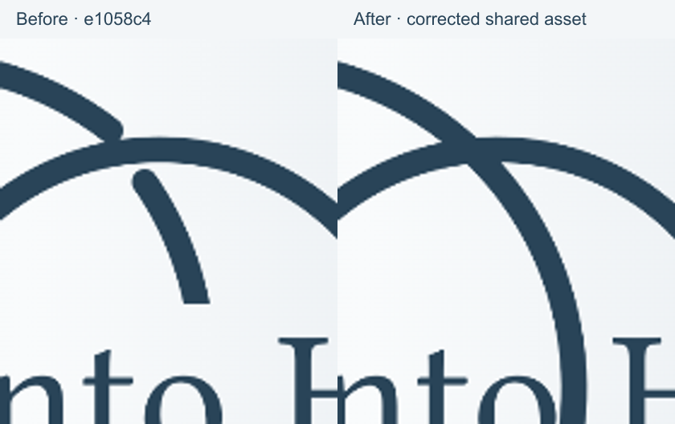
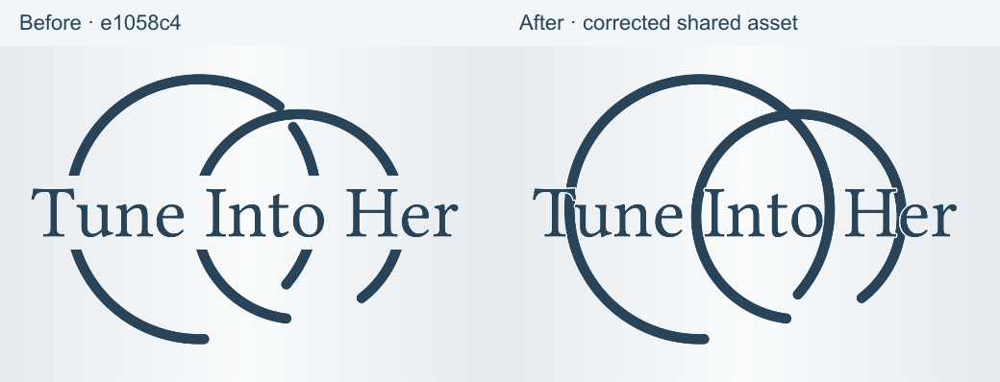
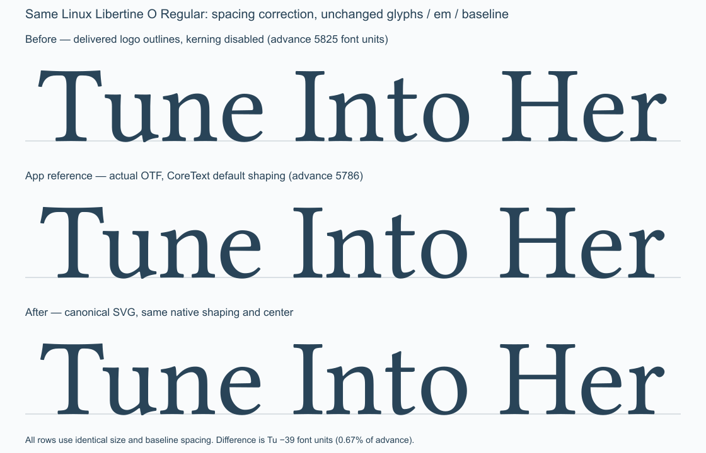
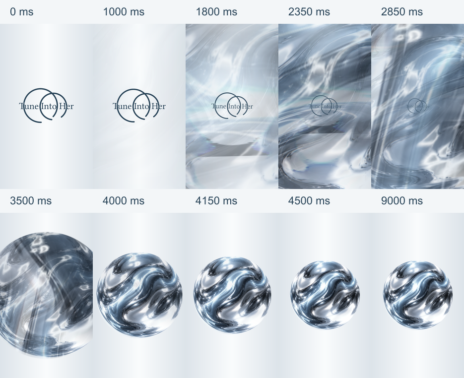

# Corrected emblem, exact typography and full intro

Recorded2026-11-14, Europe/Rome. Baseline e1058c4; current working branch
codex/monetization-20261113. This supersedes the prior extra-second hold and original
broken-arc/rectangular-clearance policy. No app publication or production configuration change.

## Result

The left main arc and its former detached right fragment used different circle centers.
They now form one continuous open circular trajectory on the original main circle.
The second open arc, original outer bounds,19/15 radii,1.5 stroke, round caps, ink and
composition are retained. The lower ends remain open; no complete circles or extra rings
were invented. Letter contours mask only their local clearance and paint over the rings,
replacing the empty full-width y153–239 strip.

[Authoritative SVG](../assets/brand/official-mark.svg) supplies the shared generated
vector/PNG, native loading, static fallback, opening and Home replay. BrandMark imports
the same arc data. The iOS PNG copy is updated; the existing Android plugin regenerates
all five density/day-night resources from the same canonical PNG.

The actual approved font is assets/fonts/LinuxLibertineO-Regular.otf, Linux Libertine O
Regular5.3.0, PostScript LinLibertineO, weight400. Its trusted SHA6332761e… remains
unchanged. Existing glyph outlines already match the font; the correction applies native
default “Tu” kerning−39 font units and recenters the advance (+1.673819745 design units).
Glyph shape, weight, em scale0.08583691 and baseline224 are unchanged. This is an actual
spacing correction within the same typeface, not a substitute font.

The original9000ms timeline, all six depth layers, camera/motion speed, scene runtime,
V4 shaders, clean texture and poster remain byte-identical to baseline. The extra1000ms
hold and its unnecessary JS frame timer are removed. Completed choreography plus current
destination readiness permits the existing360ms fade immediately. Slow readiness keeps
the original V4 material moving; errors, retry, foreground, reader and Reduced Motion
gates remain. No route, cycle/content, entitlement or backend code changed.

## Actual images

These before/after panels use the real shared WebGL renderer at exactly0ms,375×667,
DPR2. Crops are from captured frames; upper detail is enlarged3×, never redrawn.

The typography comparison uses actual OTF/CoreText shaping and independent SVG rasterization
at equal em, baseline and center. All264 commands/11 letters match; shaped-origin error0,
maximum glyph-coordinate error0.00003052 font units. Corrected native-reference/SVG
threshold-alpha IoU0.9985924; remaining subpixel antialias differences are not a font change.
See the [CoreText report](../tests/font-provenance/report.json) and the actual native
[Today AppText rendering](../release/evidence/brand-geometry-20261114/light-entry.png).

## Completed checks

| Check | Actual evidence |
| --- | --- |
| TypeScript | PASS |
| Full application suite |369 tests /41 files PASS |
| Targeted brand/splash/launch/V4 rerun |50 tests /6 files PASS |
| Font coverage and license |14 tests /2 files PASS; OTF/full notices unchanged |
| ESLint |0 errors;1 existing generated router warning |
| Content generation check |610 bundles,11 locales,90-day reserve PASS; content unchanged |
| Source and raster reproducibility |Generator --check --raster-check PASS; exact native alpha/tint and iOS bytes PASS; integrity hash tests updated, retained |
| Shared WebGL |72 checkpoints /4 phone ratios,0 exceptions/GL errors; all layer indices0–5 captured; original timeline/scene/shader SHA unchanged |
| iOS Simulator Release |Signed build/install PASS; embedded official manifest/fingerprint exact; JS aee581e3…; Metro8081/8082 absent |
| Native Light/Dark |Saved Dark survives Home and cold restart; white-clock pixel checks; Light restored.72.506s PASS |
| Native Home single/double tap |Clean foreground repeat37.451s PASS:12.710s single /11.691s double, one cover, same process, locked destination |
| Native Reduced Motion |UIKit ON24.984s, cold locked entry7.834s without full scene, UIKit OFF restored6.525s; all PASS |
| Physical iPhone Release |Build/sign/official resources/install/launch PASS, no data reset, no Metro. Cold-relaunched process observed running+54.956s. Physical pixels/speech not captured |
| Android resource generation |Offline isolated prebuild PASS;10 PNGs, all5 densities, day/night identical,0 RGBA/alpha differences from official algorithm,0 pixels outside96dp safe circle |
| Android production JS |Export PASS, entry-430ae195ed4b4e774b8aa4dc91dfb908.hbc |
| Android native runtime |Unavailable: no JDK/JRE, Android SDK, adb or emulator; Gradle stops before compilation. No APK/TalkBack/Android flash-free claim |

The first Home timing run while other builds/exports were active failed the17.5s
threshold (double18.525s); no extra scene was established. The next attempt began with
Settings foreground after the OS motion restoration and failed an AX snapshot before a
gesture. With the expected app-foreground precondition and other builds stopped, the
unchanged37.451s Home test above passed. Both failed raw results remain in /tmp.

[Final standalone native movie](../release/evidence/brand-geometry-20261114/native-after.mp4) ·
[opening](../release/evidence/brand-geometry-20261114/native-opening.png) ·
[depth](../release/evidence/brand-geometry-20261114/native-depth.png) ·
[sphere](../release/evidence/brand-geometry-20261114/native-sphere.png) ·
[correct destination](../release/evidence/brand-geometry-20261114/native-final.png).

## Cold-start boundary

The first launch immediately after Simulator binary replacement recorded SpringBoard,
then approximately two seconds of black before the silver native bridge. The subsequent
intro/depth/final-sphere→locked-entry sequence was complete. This observation is retained,
not counted as a flash-free first-install pass. A quiescent repeat of the same installed binary passed: all690 decoded frames checked,
zero black app-area frames, complete intro and protected entry. A final data-preserving quiescent reinstall of the exact same binary also passed:
all724/724 original frames checked, zero black frames, complete corrected logo→six-layer
scene→original sphere→locked entry. The calibrated detector identifies44/680 black frames
in the first recording. The first observation remains; no causal explanation or universal
native-first-install guarantee is inferred.

Source-frame checkpoints are not a native timing measurement. The native recorder's media
timestamps differ from measured wall time, so this report does not promise a nine-second
total OS launch. Bootstrap/font/GPU readiness can precede the9000ms choreography. Existing
sphere-only portion within the approved nine seconds remains animated and intentional.

Real VoiceOver/TalkBack speech, physical-device visual approval and Android native runtime
remain open; source coverage verifies skip/gate behavior. This is not store-release readiness.

## Changed implementation files

- assets/brand/official-mark.svg and scripts/generate-intro-brand.cjs: authoritative
  open arcs, exact OTF glyphs/native spacing and reproducible shared asset generation.
- src/intro/brand.generated.ts, brandTexture.generated.ts and src/components/BrandMark.tsx:
  regenerated runtime assets and one shared native arc source.
- assets/launch/generate.cjs, official-launch-mark.png and the tracked iOS LaunchLogo PNG:
  consistent native pixels; existing Android plugin/config unchanged.
- src/intro/launchState.ts and GlobalLaunch.tsx: remove final fixed hold/JS timer;
  readiness and foreground ownership retained.
- tests/brandGeometry.test.ts, introRuntime.test.ts, launchState.test.ts,
  launchReadiness.test.ts, intro-frames/capture.cjs and font-provenance/*:
  new geometry/spacing, reviewed asset hashes, complete-layer evidence and no-hold regression.
- Architecture/snapshot/tasks and brand/native-launch QA docs/evidence: current facts,
  reproduction, images and explicit remaining platform/runtime limits.

sphereHtml.ts and timeline.ts were inspected and deliberately remain byte-identical,
as do V4/scene runtime, sphere textures, font binary, navigation, billing and configuration.

## Reproduce and review

[Shared source/generation instructions](../assets/brand/README.md) include the explicitly
pinned build-time renderer outside app dependencies, full raster check and independent
font audit. tests/intro-frames/capture.cjs captures the actual shared renderer with the
deterministic clock and records all six visible layer indices. Native tests use the
existing guarded synthetic Simulator harness; no real cycle or billing actions occur.

[Evidence index](../release/evidence/brand-geometry-20261114/README.md). Raw build/test
logs, full-resolution frames and xcresults are under /tmp/tih-brand-correction and
/tmp/tih-launch-native-uiqa; private device inventory/install logs are excluded from Git.
