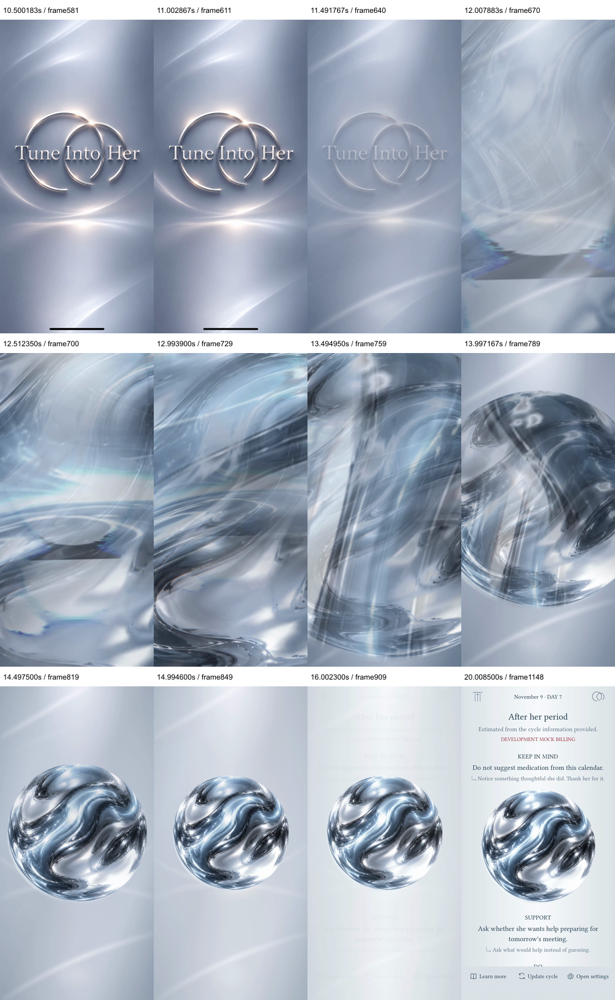
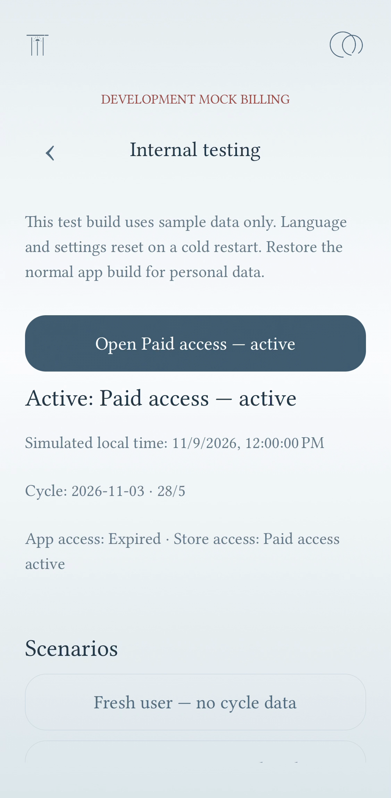
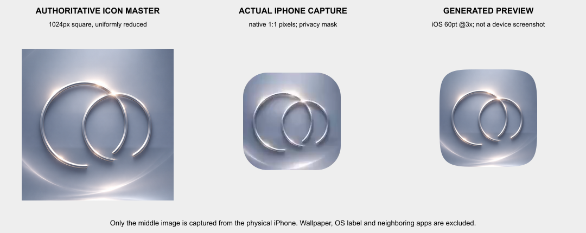
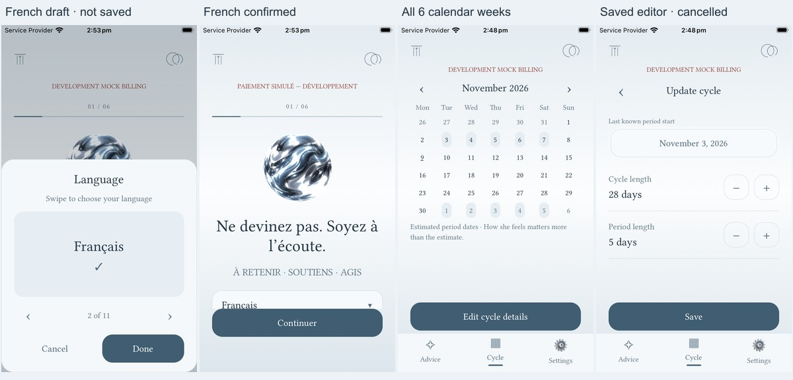
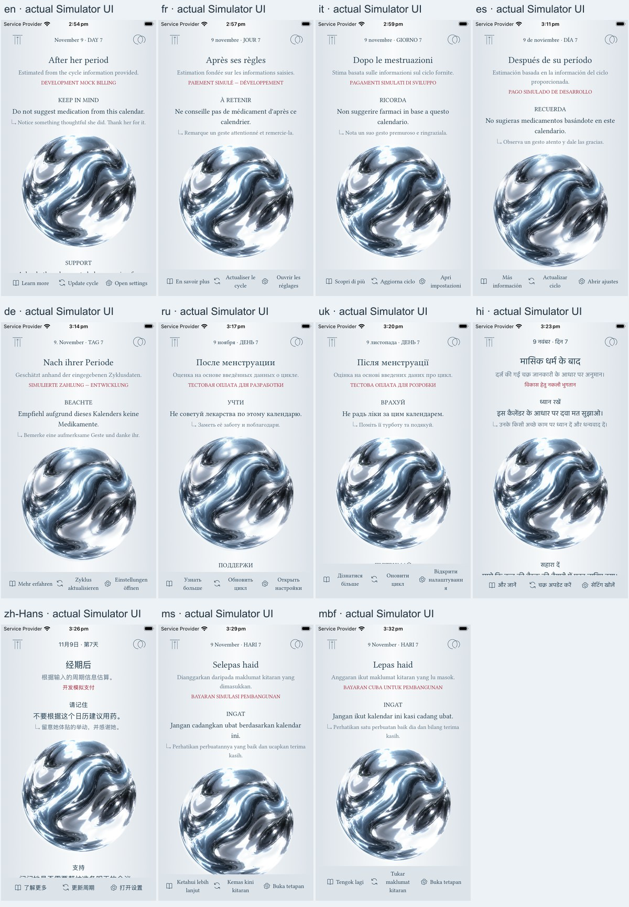
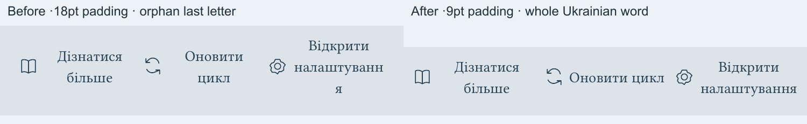

# Final UI, language, education and Founder QA pass

Date: 2026-11-15. Branch: `codex/monetization-20261113`.
Checkpoint: `codex/checkpoint-ui-final-pass-20261115` → `3eff34d`.
Implementation checkpoint: `6c8d2d70ccad3bcc6bb2e13acf236b76a923b92c`.
Final spacing-corrected source checkpoint: `4e04a30b580aa97ea8281517705a60401e4c918d`; final iPhone update/capture accepted below.
The latest Founder brief supersedes the earlier wordmark-in-icon and automatic-normal-restore requirements.
No uninstall, reset, backend/billing setup, store publication or merge is part of this pass.

## Implemented

- The shared secondary footer uses only a left arrow and the existing system gear. Both
  retain localized accessibility labels,48-point targets, safe areas and original routing.
  Main Advice/Cycle/Settings tabs are unchanged.
- Initial language choice is a horizontal11-page draft carousel with swipe, previous/next,
  adjustable accessibility, visible current choice and explicit Done/Cancel. It retains the
  existing preference persistence and has an accessible large-text scroll fallback.
- All11 locale resource trees include the new picker, QA and legal copy. Today no longer
  uses hardcoded Russian/English chrome. iOS date/time spinners receive the selected locale;
  formatter identifiers map Baba Malay to `ms` and Simplified Chinese to `zh-CN`.
- Cycle removes duplicate heading and excess spacing, keeps the full42-date/six-week grid,
  clear month heading,44-point month buttons and the fixed Edit cycle details action.
  Dynamic Type can still scroll rather than clipping or shrinking text.
- Today Learn more opens real bundled education, including when cycle confirmation is due.
  Four selectable phases each explain timing, physical patterns, energy/emotions and partner
  support. Every page states individual variation; the general introduction excludes mood
  prediction, diagnosis, fertility and contraception use. No engine or daily advice changes.
- The private standalone bundle now defaults to the existing localized internal QA panel.
  Settings reopens it, every existing scenario is reused, and Reset remains synthetic.
  `--entry today` exists only as an explicit capture variant. Normal production eligibility,
  AppProvider, routing and real purchase/trial implementations remain unchanged.
  First-entry QA language/theme seeds are copied into memory without reading personal stores.
- The icon now contains only the original silver open rings. A bounded imagegen edit removes
  lettering and reconstructs the occluded arcs; all pixels outside the edit band are exact
  original pixels. Original portrait/wordmark/splash remain untouched.1024iOS,512Play and
  separate safe adaptive layers/native AppIcon come from the same deterministic pipeline.

## Medical source provenance

These actual pages were opened and checked on November15. They are institutional general
information, not a claim of clinical review of this product or translations:

- [NIH / NICHD — About menstruation](https://www.nichd.nih.gov/health/topics/menstruation/conditioninfo):
  the cycle, follicles, uterine lining and ovulation.
- [NHS — Periods](https://www.nhs.uk/conditions/periods/): bleeding duration and variable
  ovulation timing before the next period.
- [NHS — Premenstrual syndrome](https://www.nhs.uk/conditions/pre-menstrual-syndrome/):
  possible physical/emotional symptoms, variation and when to seek medical advice.

Support suggestions are relationship guidance, not medical treatment attributed to these
sources. The app labels external sources as English; source-link failure is recoverable.
All educational prose is bundled and works offline. The original font licence remains
verbatim English with a localized explanation and explicit English accessibility language.
Endonyms in language selection and institutional/product names are intentional.

## Verification

-517 tests across54files PASS with one worker after packaging finished; TypeScript PASS;
  lint0errors/one pre-existing generated Expo warning. Earlier runs while several Metro
  exports/captures competed for host resources hit the unchanged5s PNG integrity timeout;
  no assertion, hash guard or timeout was disabled to obtain the final pass.
- Own-locale resolution with English fallback disabled and actual preference save/load are
  tested for all11languages. Android draft chooser has19 actual-component cases, including
  every locale, leap/maxdate clamping, explicit confirmation/cancel and iOS regression.
- Canonical icon hash/raster regeneration and protected launch/V4 checks PASS.610 distinct
  three-part bundles across11locales remain generated from318 authored texts per locale.
- Actual actool catalogs compiled for iphoneos and Simulator; all4 launch rendition metadata/
  digests match the earlier verified catalog exactly. Only AppIcon changes. Android official
  Expo resource generation verifies20density files/2XML; production Android Hermes export PASS.
- Current normal/private iOS Release bundles are source-identified, graph-verified and signed.
  Native executable excluding signature, frameworks, profile and non-icon Info values remain
  exact. Native assets were compiled; this does not claim a full Swift rebuild or store upload.
- Physical final51-input Today25.670s and panel25.368333s plus the unchanged-catalog Home-icon proof PASS
  without Metro. All before/after personal AsyncStorage snapshots equal; final panel update
  and launch succeed, and the Founder private test artifact remains installed.
- Native SE375×667 test passes all4 phase pages/16 paragraphs/sources, fixed accessible arrow/
  gear/Back behavior,42 visible dates, reachable Edit/prefill/cancel and the same process.
  Native horizontal swipe/draft/cancel/confirm/English cleanup PASS. All11 locale assertion sequences completed (8independent passed cases and3explicit
  EN/FR/IT checkpoints from an otherwise failed aggregate). Normal Release Russian cold
  persistence/English cleanup PASS39.084s; current QA Today/Cycle smoke PASS40.740s.

Accepted media distinguishes native screenshots/video from generated icon/store-mask previews.
Failed or short physical recordings are never accepted as a complete startup. Public evidence
excludes personal storage, identifiers, unrelated OS labels and wallpaper. Host recorder uses
actual frame-arrival times; clips preserve those recorded intervals and do not synthesize
frames or refit native GPU/hold timing. Repeated MovieFileOutput error-11813 fragments are
retained privately and rejected; removing captions alone was not a reliable fix.

## Limits

Android resource generation is verifiable here; native Android build/emulator execution
requires a working Android SDK/JDK, unavailable on this host. The installed Android system picker follows OS language; the final pass therefore
replaces all three Android date/time entry points with one app-owned, localized draft
modal. Its component behavior is tested separately; no Android native runtime acceptance
is claimed without that toolchain. Native-speaker review (especially Baba Malay),
clinical content review and real reader speech remain separate from schema/device proof.
The internal build's test preferences/history are memory-only and reset on cold launch;
normal saved-language persistence is a separate check. Personal Keychain is not read/hashed.

## Actual final iPhone media

[Photo → all existing depth stages → V4 → actual Today video](../release/evidence/final-ux-20261115/physical-final/actual-iphone-photo-to-today.mp4)

Only the middle image in the icon comparison is a physical capture, retained at native1:1
pixel size. The first Home source frame proves the rings-only icon and matching OS name;
all later unrelated private UI is excluded. Wallpaper, neighbours and OS-label pixels are
removed by a conservative inset mask;30,473 opaque pixels remain source-exact,339 partial
alpha edge pixels are recorded separately. No equality with the1024master pixels is claimed.
The icon master/store/mask previews remain [here](../assets/icons/previews/platform-preview-sheet.png),
with the full [1024master](../assets/icon.png) and separate [512Play export](../assets/icons/play-store-512.png).

The final physical sequence publishes568/568 consecutive selected frames with their host-arrival
intervals unchanged (one constant start offset, maximum rounding error1µs). It excludes OS
zoom/prelude, crops only the top140system pixels, and retains native1126×2296app pixels.
Actual Today text is visible; the offscreen DO body is not claimed as visible. The entire
1487-frame Today and1482-frame panel sources each passed the defined luma flash check.
[Frame/source/privacy metadata](../release/evidence/final-ux-20261115/physical-final/proof.json),
[actual icon proof](../release/evidence/final-ux-20261115/physical/icon-proof.json) and
[precise preservation scope](../release/evidence/final-ux-20261115/physical-final/preservation.json)
distinguish observation from inference. No raw phone movie, personal digest or identifier is published.

## Final localized-footer correction

Native visual review found a single Ukrainian orphan letter in Today’s custom footer
on375pt width. The approved font’s14pt CoreText width for «налаштування» is89.95pt;
the old label slot was84.67pt. Reducing that footer’s horizontal padding18→9 gives90.67pt
without changing text, font, icons, hit-target minimums or routing. Ordinary primary tabs,
all26 protected renderer/texture/timeline/launch inputs and English footer height are
unchanged. Fresh source-identified native artifacts include this wrapper explicitly;
focused native validation and refreshed physical evidence are recorded below.

## Native Simulator screenshots and recordings

[Actual horizontal swipe, cancellation and confirmation video](../release/evidence/final-ux-20261115/simulator/language-horizontal-swipe-cancel-confirm.mp4)

[Actual phase pages and fixed arrow/gear footer](../release/evidence/final-ux-20261115/simulator/README.md)

[All eleven updated native footer crops](../release/evidence/final-ux-20261115/simulator/footer-width/all11-native-footer-contact.png)
show intact text and accessible44pt minimum hit targets. EN remains48pt high; the other
rows are56pt except MBF’s three WHOLE-word lines at76pt. The focused aggregate retains
10completed checkpoints but remains FAILED because its initial universal two-line
constraint was too strict for MBF; the MBF-only follow-up PASS24.111s confirms the natural
three-word wrap and English restoration. No translation or font was shrunk to satisfy it.
The new51-input artifact cold recording has1741decoded frames,0black and verified native
stage ordering. Earlier50-input route/current-cold evidence and these51-input footer-only
checks are explicitly separated in the [native verification](../release/evidence/final-ux-20261115/simulator/native-verification.json)
and [footer verification](../release/evidence/final-ux-20261115/simulator/footer-width/verification.json).
Failed driver attempts/zero-test selections are not relabelled as passes. Raw logs/result
bundles/identifiers remain private; only reviewed synthetic UI and bounded clips are copied.

## Final physical update completed

Both final signed artifacts bind51 inputs, including `AnimatedToday.tsx`, to checkpoint
`4e04a30`. Actual embedded bundles, Assets.car hashes and strict signatures match their
records. Both update-install receipts succeed without uninstall/reset; both cold captures
have Metro ports closed. The retained historical50-input implementation proof is available
[separately](../release/evidence/final-ux-20261115/physical/README.md).

The final continuous video starts at the fully expanded approved photograph after OS zoom,
retains source frames581–1148 /PTS10.500183–20.008500s, and reaches actual Today text.
Its9.525667s duration includes the existing depth travel, V4 and content fade; no selected
frame is dropped or retimed. Source intervals use host arrival, not native/GPU timing.
Four independently rehashed personal AsyncStorage snapshots match exact bytes and parsed
manifests (one file/two entries each). The last snapshot is after panel capture, before
final panel relaunch. Keychain and post-relaunch storage were not inspected.

The private Founder panel remains installed and final relaunch exits0. The real Home-icon
capture is reused only because both final native catalogs are identical to that observed
catalog; no new Home recording is claimed. All public media excludes private prelude,
status/return-app information and personal storage or device identifiers.

## Changed files

- Secondary controls/calendar: `SecondaryNav`, `Screen`, `BrandHeader`, `CycleCalendar`, `app/cycle`.
- Language and inputs: `LanguagePicker`, `languageSelection`, `SettingsRow`, `CycleDateField`,
  `AndroidDateTimePicker`, onboarding/reminder/language routes, UI authoring files and locale dictionaries.
- Education: `app/learn/[phase]`, `education.json`, `cycleEducation.ts`; shared source links are constant.
- QA: `app/dev-qa`, the memory controller’s locale/theme seed and false build descriptor,
  explicit standalone build tooling and host/simulator QA harnesses.
- Branding: deterministic icon generator, immutable-edit provenance, masters/adaptive/export/previews
  and actual iOS AppIcon input. Original portrait, wordmark, fonts and26 protected inputs stay exact.
- Today: localized chrome and the single measured horizontal-padding correction. Main tab design,
  cycle engine, daily catalogue, real purchase/trial services and backend have no source changes.

[Complete changed-file inventory](../release/evidence/final-ux-20261115/changed-files.txt) and
[verification summary](../release/evidence/final-ux-20261115/verification.json) accompany the media.
The source checkpoint and final follow-up commit preserve history; stores and production are untouched.
